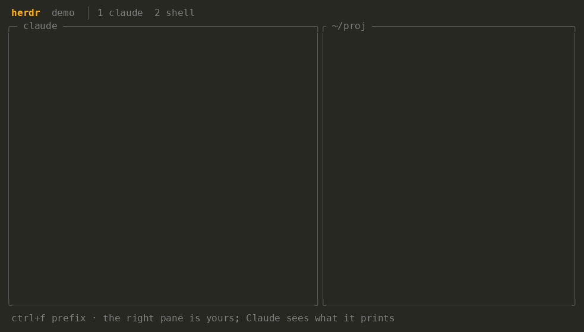

# maurelians-claude-marketplace

Personal Claude Code skills for [@maurelian](https://github.com/maurelian).

> **User-level install required.** These skills reference paths under `~/.claude/plugins/` and must be installed at user scope, not project scope.

## Install

```bash
claude plugin marketplace add https://github.com/maurelian/maurelians-claude-marketplace
claude plugin install maurelians-skills --scope user
```

## Skills

| Skill | Description |
|-------|-------------|
| `/address-pr <number>` | Address PR review comments — fetches unresolved threads, makes fixes, replies, and resolves |
| `/good-pr [number]` | Prepare a PR for review — clean history, minimal changes, reviewer-oriented description, self-review |
| `/space-name <description>` | Rename the current herdr space to describe this session |
| `/set-topic <description>` | Set the status line task label (shown in Claude Code status bar) |
| `/setup-statusline` | One-time setup to configure the Claude Code status line |

## herdr-collab

Skills for working alongside Claude in [herdr](https://github.com/herdrdev/herdr).

```bash
claude plugin install herdr-collab --scope user
```

Say "watch my pane" and the pane next to Claude becomes a shared terminal: whatever
you run there reaches Claude on your next prompt, and Claude can type commands back
into it.



| Skill | Description |
|-------|-------------|
| `herdr-collab` | Share the sibling pane as a live terminal Claude reads from and types into |
| `herdr-space` | Create a herdr space, or a child space on its own git worktree, optionally with an agent on a task |
| `herdr-archive` | Archive a space's layout and agent sessions to a file and close it, or restore it later |
